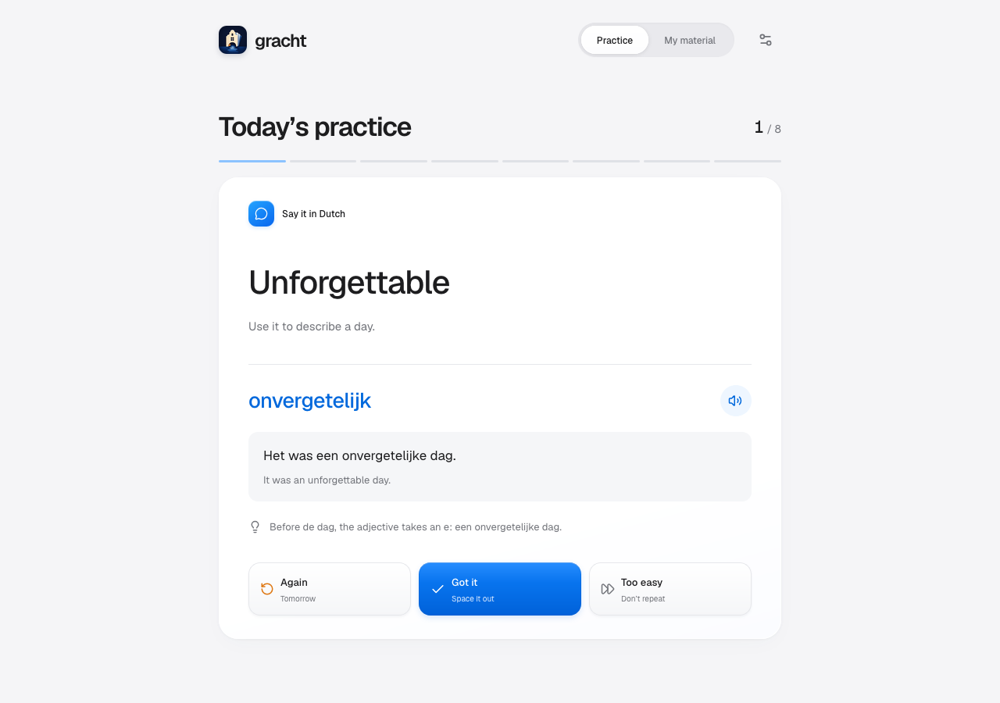
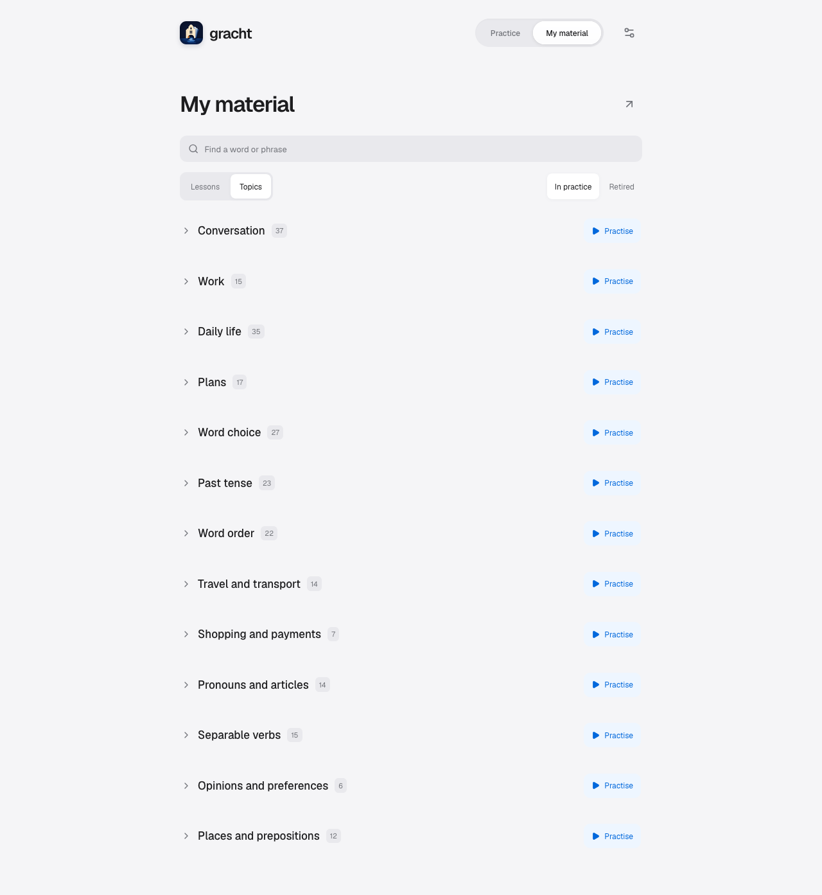
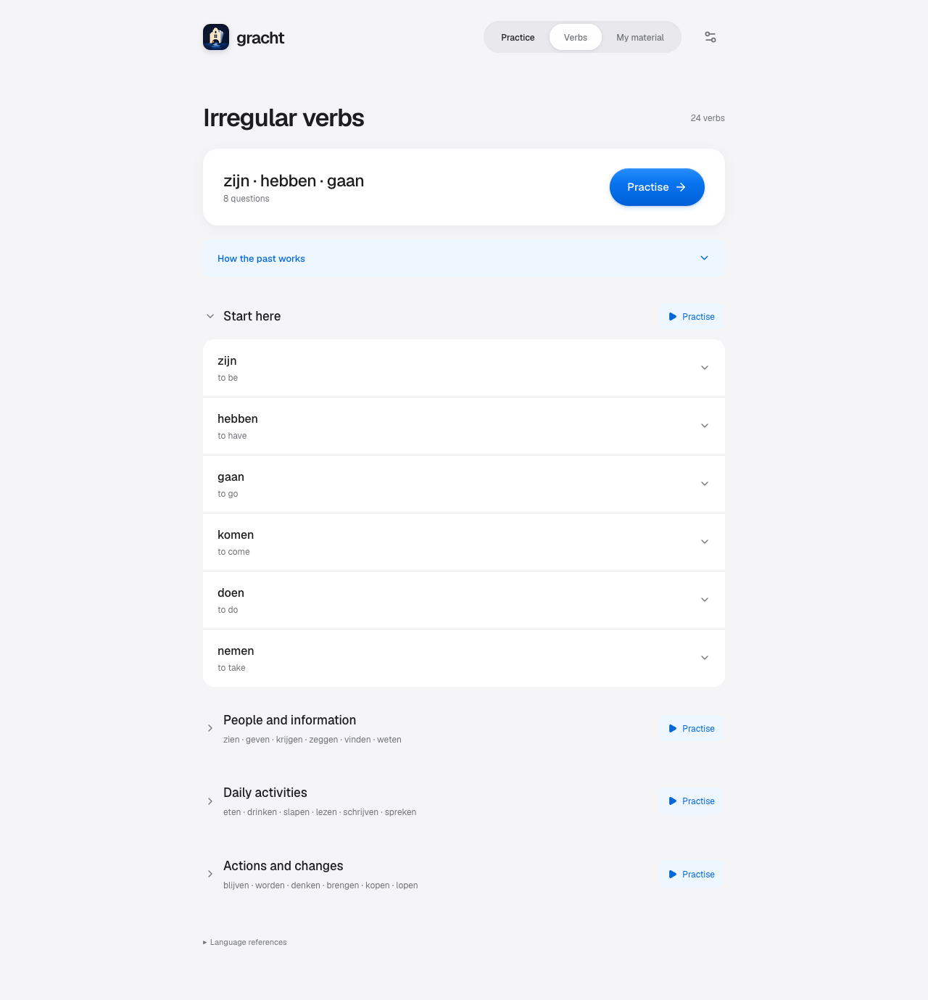

# gracht.app

[Open the app](https://evgeny.io/projects/gracht.app/)

Gracht is a personal Dutch practice app built from notes shared with a teacher. Exercises are curated manually from those lessons. Daily sessions mix up to eight tasks, giving recent material priority while bringing earlier exercises back for review.

Progress stays in your browser. The app works offline after its first load and can play Dutch examples using the voices available on your device. Light and dark themes follow your device or your preference.

## Daily practice

Recall words and expressions, explain a word choice, build a phrase from shuffled pieces, or change a verb inside a sentence. Answer aloud or think it through, then reveal the model and rate your attempt.

| Rating | What happens |
| --- | --- |
| **Again** | Returns the next local calendar day, ahead of new exercises. |
| **Got it** | Spaces reviews out by 3, 7, 14, 30, then 60 days as you keep succeeding. |
| **Too easy** | Retires the exercise until you bring it back from My material → Retired. |

Undo restores the previous schedule for your last answer.



## Practise a lesson or topic

Search My material or browse by lesson date and topic. Start a session from any group, or open an exercise to practise it individually.

Group sessions include active exercises even when they are not due yet. They run in batches of up to eight; **Keep practising** continues through the group without repeating completed exercises. Retired items stay excluded. **Return to daily** resumes the daily queue.



## Irregular verbs

The **Verbs** section starts with 24 useful verbs, beginning with `zijn`, `hebben` and `gaan`. Each verb has separate questions for meaning, recognising a past form, singular and plural past forms, the perfect, and building a sentence. Translation goes both ways between Dutch and English.

Sessions contain up to eight questions. Due reviews come first, with missed questions given priority. Suggested practice introduces new questions from up to three verbs at a time. Choosing a group or an individual verb lets you practise its full set, including questions that are not yet due. The same ratings and backup support apply; retired verb questions can be restored from that verb’s details.

**How the past works** compares simple past (OVT) with perfect (VTT), including plural forms and contextual examples of `hebben` and `zijn`. Verb forms and authored examples live in `src/verbs/library.ts`, separately from the teacher’s notes. Grammar references are [Taaladvies on past tenses](https://taaladvies.net/werkwoordstijden-die-iets-over-het-verleden-zeggen-voltooide-versus-onvoltooide-tijden-algemeen/), [Taaladvies on hebben and zijn](https://taaladvies.net/vorming-van-voltooide-tijden-met-hebben-of-zijn-algemeen/), and the [Algemeen Nederlands Woordenboek](https://anw.ivdnt.org/).



## Updating lesson material

Content lives in `src/practice/library.ts`, including the teacher’s Google Doc link as `DOCUMENT_URL`. Updates can be requested or run by the owner's local Codex automation after lessons. The personal `gracht-lesson-update` skill reads the whole document, curates exercises, checks them and publishes through the existing GitHub workflow.

To add a lesson:

1. Add a lesson with a stable ID and increasing `sortOrder`. Use its source date, or `null` for undated notes.
2. Give new exercises unique stable IDs and `revision: 1`. Assign `topicIds` from the exported topics. Preserve exact source quotations and mark adapted examples with `source.adapted`. Check model answers independently where the notes contain mistakes.
3. For phrase builders, provide tokens and accepted answers using the same words. Include natural alternative orders. Verb exercises need a subject and a concrete situation.
4. Keep existing IDs to preserve history. Increase `revision` when a changed task or answer needs fresh practice; this makes it due again, including previously retired items. Cosmetic edits can keep their revision.
5. Run the validation and practice tests below, then inspect the changed exercises locally.

Source quotations stay in the data for future checks. The interface shows the curated answer, example and explanation. To verify quotations against a private source extract:

```bash
npm run validate:practice -- /path/to/source.json
```

The JSON extract must include the configured `documentId` and a `paragraphs` array with `text` and `tabId` fields. For quoted image text, add an `images` array with each image's `id`, `tabId`, `contentHash` (`sha256:` followed by the image-byte hash) and reviewed `paragraphs` as strings. Keep image files and full transcriptions outside Git.

To compare a complete Google Docs extract with the last applied source:

```bash
npm run lesson:source -- compare /absolute/path/to/source.json
```

This checks ordered paragraphs across all tabs, including edits to older notes, and reports changes to images separately. Confirm coverage of all tabs and embedded images before comparing; the text API omits image content. Include every image in the manifest, even when it needs no transcription, or use an empty array for a document without images. The personal skill includes a helper that downloads image bytes and carries forward transcriptions only when the bytes still match. After images have been tracked, a missing manifest is rejected as an incomplete read.

`scripts/teacher-sync.json` records the normalized source hash, paragraph count and imported exercise IDs. Full source snapshots stay outside Git, in `$CODEX_HOME/skills/gracht-lesson-update/state/teacher-source.json` (default `~/.codex`). A missing baseline requires reconciliation. `publication-unconfirmed` means the source matches the repository checkpoint but publication still needs verification against the applied baseline. Resolve any pending deployment before treating a run as unchanged or adding newer notes.

When publishing a content update, update the public checkpoint with the reviewed source hash and import decisions. Once the app workflow, the website's Pages deployment and a live Firefox check succeed, save the private baseline:

```bash
npm run lesson:source -- checkpoint /absolute/path/to/source.json
```

The command refuses a source that differs from the public checkpoint. Unchanged notes and administrative additions produce no commit. Keep both applied checkpoints intact until there is a substantive content update. Scheduled local runs require the computer to be awake with Codex running and its source and GitHub connections available.

## Backups

Export or import a JSON backup from Settings. Version 2 includes lesson progress, retired items, review history and preferences. Import validates the full file before writing.

Progress is stored separately on each device. Export a backup before clearing browser storage or moving to another browser. Earlier flashcard data remains in backups for compatibility; restoring a version 1 backup replaces that data while preserving lesson practice.

## Development

```bash
npm ci
npm run dev
```

Open the local URL printed by Vite. Checks:

```bash
npm run lint
npm run validate:practice
npm run validate:decks
npm run test:practice
npm run test:verbs
npm run test:lesson-source
npm run build
```

The build includes TypeScript checking. Run `npm run preview` and open `/projects/gracht.app/` to inspect the production build at its deployed base path.

## Deployment

Pushes to `main` deploy through GitHub Actions to [the live app](https://evgeny.io/projects/gracht.app/).
